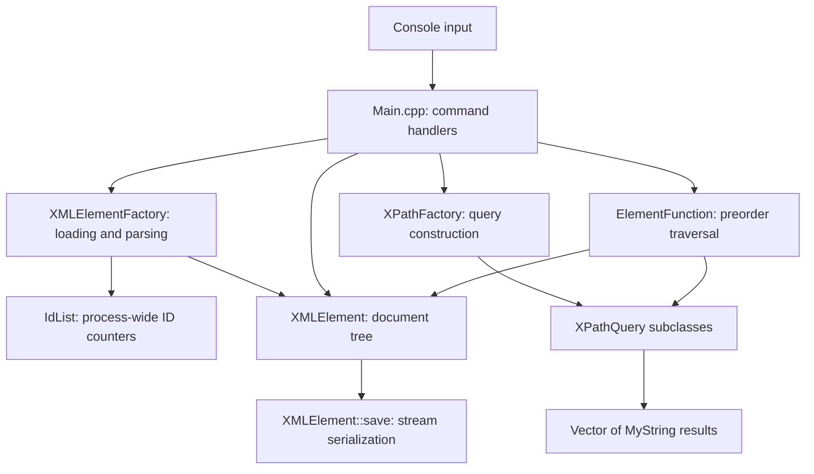

# Architecture

XMLParser is a single-process, synchronous console application. It loads XML
into an owned tree, applies commands to that tree, and serializes it back to a
file. Parsing, tree operations, and query evaluation use custom string and
container classes. There are no external XML libraries, background workers,
or database services.

## Component relationships

The arrows below show calls or use of data, rather than ownership.

| Component | Responsibility and boundary |
| --- | --- |
| [Main.cpp](../XMLParser/XMLParser/Main.cpp) | Reads commands, prompts for arguments, tracks the active document, and performs file I/O for saves. It directly coordinates the other components. |
| [XMLElementFactory](../XMLParser/XMLParser/XMLElementFactory.h) | Converts file contents or XML text into a tree. It assigns IDs while parsing. |
| [XMLElement](../XMLParser/XMLParser/XMLElement.h) | Stores node data and implements attribute access, child operations, recursive searches, cloning, and serialization. |
| [IdList](../XMLParser/XMLParser/IdList.h) | Tracks how many times each ID base has been requested during the process lifetime. |
| [XPathFactory](../XMLParser/XMLParser/XPathFactory.h) | Interprets a query string and constructs the corresponding query object. |
| [ElementFunction and queries](../XMLParser/XMLParser/ElementFunction.h) | Separate tree traversal from the operation performed at each visited node. Query callbacks collect string results. |

## Application state and command execution

`Main.cpp` holds three globals: `rootElem`, the raw owning pointer to the active
document wrapper; `currFile`, the current file path; and `hasUnsaved`, the edit
flag. This permits one active document per application instance.

`runMainLoop` reads a complete command name and dispatches through an `if`/`else`
chain. Each handler reads its own arguments. Commands targeting an element use
`getElementById`, which searches the active tree and returns a borrowed pointer.
`set`, `delete`, and `newchild` mutate the tree and set `hasUnsaved`. Saving
clears the flag; `save as` also replaces `currFile`.

`main` catches exceptions around the entire loop, so a command exception ends
the session. There is no separate application service or command-object layer;
interaction, state management, and orchestration all live in `Main.cpp`.

## Document model and ownership

Each `XMLElement` contains a tag name, a text string, a sorted attribute map,
and a vector of owned child pointers. The `id` is stored as an ordinary
attribute rather than a separate field. Text belongs to the node itself;
`getText` does not aggregate descendant text. The parser handles leaf text or
child elements and does not preserve mixed content.

`XMLElement::ElemPtr` aliases `Polymorphic_Ptr<XMLElement>`. Its destructor
deletes the pointed-to element, copying invokes `clone()`, and moving transfers
the pointer. Consequently, destroying a root destroys its descendants, while
copying an ordinary parsed tree produces independent child subtrees. Pointers
returned by child access and search functions are borrowed and must not be
deleted by the caller.

The `parent` member also uses `ElemPtr`. Child insertion does not set it, and
parsed trees leave it empty. It is not a non-owning back-reference: adopting
an already-owned parent address would create competing owners.

Tree search uses a `Predicate<XMLElement>` interface. `IdPredicate` compares
the stored `id`; `findInTree` tests the current node before searching children
in order. There is no ID-to-node index, so lookup can visit the whole tree.

## Loading and parsing

The loading path is:

1. The `open` handler obtains a path and calls the file factory overload.
2. The factory reads the remaining file into `MyString` and wraps it in
   `<root id="ROOT">...</root>` so multiple top-level elements can be loaded.
3. The recursive parser uses `StringView` slices and a shared position index to
   find tags, attributes, leaf text, and child elements.
4. Each completed child is transferred to its parent's owning child vector.
   Parsing assigns an explicit or generated ID through `IdList`.
5. The factory returns the wrapper pointer to the console, which stores it in
   `rootElem` and records the file path.

The `const char*` factory overload interprets its argument as a file path;
`MyString` and `StringView` overloads parse XML text directly and do not add a
wrapper. Views only borrow the parsing buffer; the completed tree stores
owning strings, so it does not depend on that buffer after parsing returns.

`IdList` counts requests by base string. The first request returns the base;
later requests append a numeric suffix. Its static map survives file changes,
does not index tree nodes, and does not reserve all resulting suffixed names.

## Query construction and evaluation

`XPathQuery` derives from `ElementFunction` and owns a `Vector<MyString>` of
results. `PathQuery`, `AttribQuery`, and `ComparisonQuery` implement the node
callback; `FunWrapper` adapts a free function to the same traversal interface.

For the `xpath` command, `XPathFactory` examines the expression's separators
and returns a heap-allocated concrete query. The handler passes it to
`ElementFunction::traverseElementTree`, which calls the callback on the root
and then recursively on each child. The callback inspects the current node
and, when needed, its direct children. The handler prints the accumulated
strings and deletes the query.

For example, `person/name` creates a `PathQuery`. Each visited `person` node
contributes the stored text of its direct `name` children. Results follow
traversal and child order. Reusing a query appends results unless its result
vector is cleared. The query language is a limited XPath-style syntax; the
[README](../README.md#xpath-style-queries) describes its current behavior.

## Serialization

`print`, `save`, and `save as` iterate over the synthetic wrapper's children.
Streaming an element invokes `XMLElement::save`, which writes its opening tag,
attributes in map order, stored text, descendants, and explicit closing tag.
Child levels add four spaces of indentation.

Serialization regenerates the document rather than reproducing the input:
generated IDs are included, attribute ordering and whitespace can change, and
text and attribute values are written without XML entity escaping. An explicit
root element from the input remains part of the output; only the factory's
synthetic wrapper is omitted.

## Supporting types and design consequences

`MyString` owns character storage; `StringView` borrows ranges for parsing.
`Vector<T>` supplies contiguous dynamic storage. `OrderedMap<KeyT, ValueT>`
keeps pairs sorted in an array, using binary search for lookup and shifting
elements for insertion. These types are shared by parsing, nodes, IDs, and
queries. `Polymorphic_Container` and `HeterogeneVector` provide additional
container implementations, but the element tree directly uses
`Vector<ElemPtr>`. `XMLEntry` is an unused placeholder.

The full document is held in memory, with the input string also present during
loading. Parsing, searching, traversal, and saving use recursive calls, so stack
usage grows with nesting depth. Factory results and the console root use raw
owning pointers; exception paths do not have a comprehensive automatic cleanup
mechanism. Current validation, file lifecycle, and container issues are listed
in the [README limitations](../README.md#current-limitations).

For API contracts, extension points, and validation guidance, see the
[developer guide](DEVELOPMENT.md).
